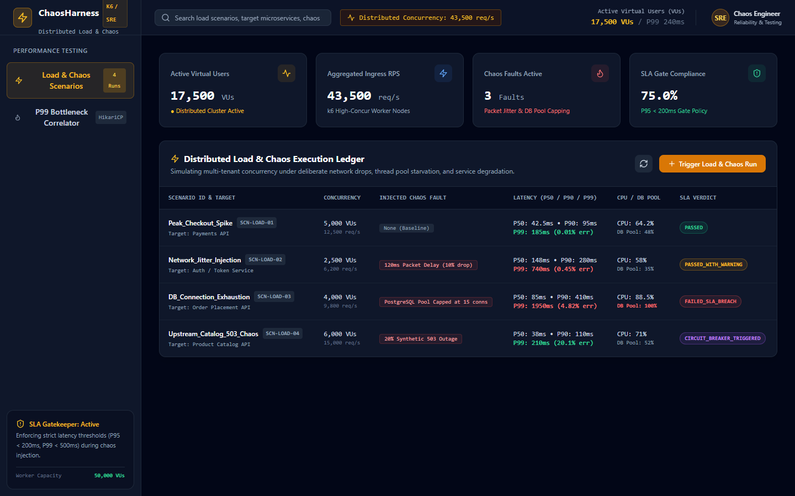
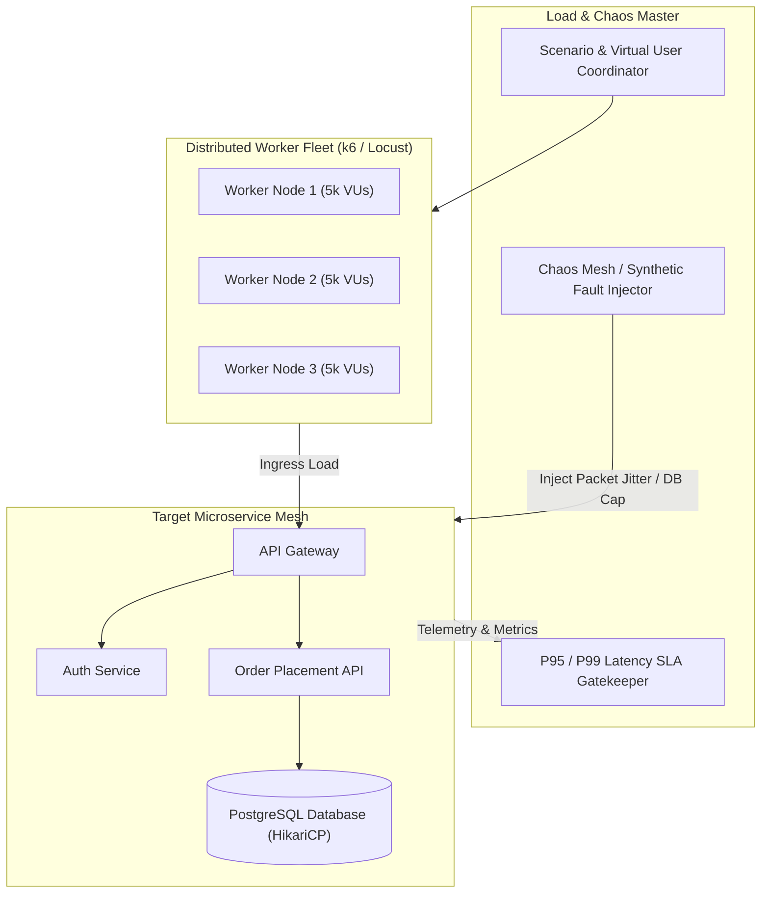

<div align="center">

# ChaosHarness — Distributed API Load & Chaos Testing Platform

[](LICENSE)
[](https://k6.io/)
[](https://github.com/Prasunnandi/chaos-load-testing-harness)
[](https://github.com/Prasunnandi/chaos-load-testing-harness)
[](https://reactjs.org/)
[](https://docker.com)

**Distributed multi-scenario load testing harness with real-time chaos fault injection (packet jitter, TCP drops, HikariCP connection starvation), tail latency percentiles (P50/P90/P99), and automated bottleneck root-cause attribution.**

[Architecture](#system-architecture) • [Live Dashboard](#live-dashboard-preview) • [Benchmark Data](#benchmark-dataset) • [API Reference](#rest-api-documentation) • [Quickstart](#quickstart-guide)

</div>

---

## Live Dashboard Preview

<div align="center">
  
</div>

---

## Core Capabilities

- **High-Concurrency Distributed Load Generation:** Simulates ramp-up, spike, and endurance soak tests across thousands of virtual users (VUs) and up to 50,000 req/s.
- **Dynamic Chaos Fault Injection:** Injects synthetic network packet drops, artificial latency, database connection pool starvation, and upstream 503 outage errors mid-test.
- **Tail Latency Percentiles (P50 / P90 / P99):** Tracks distribution percentiles across microservice boundaries to detect latency degradation before end users are impacted.
- **Multi-Variate Bottleneck Attribution:** Correlates tail latency spikes directly with container CPU saturation, JVM thread contention, and database pool queue exhaustion.

---

## System Architecture



---

## Benchmark Dataset

Standard distributed load and chaos benchmarks in [`data/kaggle_chaos_load_test_benchmark.csv`](data/kaggle_chaos_load_test_benchmark.csv):

| Scenario ID | Test Name | Target Service | Virtual Users | Chaos Fault | P99 Latency | Verdict |
| :--- | :--- | :--- | :--- | :--- | :--- | :--- |
| `SCN-LOAD-01` | Peak_Checkout_Spike | Payments API | 5,000 VUs | None (Baseline) | 185 ms | `PASSED` |
| `SCN-LOAD-02` | Network_Jitter_Injection | Auth / Token Service | 2,500 VUs | 120ms Packet Delay | 740 ms | `PASSED_WITH_WARNING` |
| `SCN-LOAD-03` | DB_Connection_Exhaustion | Order Placement API | 4,000 VUs | Pool Capped at 15 conns | 1,950 ms | `FAILED_SLA_BREACH` |
| `SCN-LOAD-04` | Upstream_Catalog_503 | Product Catalog API | 6,000 VUs | 20% 503 Outage | 210 ms | `CIRCUIT_BREAKER_TRIGGERED` |

---

## REST API Documentation

### 1. Trigger Load & Chaos Scenario
```http
POST /api/v1/chaos/scenarios
Content-Type: application/json

{
  "testName": "Payment_Checkout_Spike_Chaos",
  "targetService": "Payments Microservice",
  "virtualUsers": 3500,
  "targetRps": 9000,
  "chaosFault": "150ms Synthetic Latency Injection"
}
```

### 2. Retrieve Load Scenarios & Metrics
```http
GET /api/v1/chaos/scenarios
```

---

## Quickstart Guide

### Prerequisites
- Node.js 18+ or Docker & Docker Compose
- Git

### Running Locally

```bash
# Clone the repository
git clone https://github.com/Prasunnandi/chaos-load-testing-harness.git
cd chaos-load-testing-harness

# Start Backend API
cd backend
npm install
npm start &

# Start Frontend Client
cd ../frontend
npm install
npm run dev
```

### Running with Docker Compose

```bash
docker-compose up --build
```
Navigate to `http://localhost:3000` to inspect the load test and chaos control center.

---

## License

Distributed under the MIT License. See `LICENSE` for more information.
